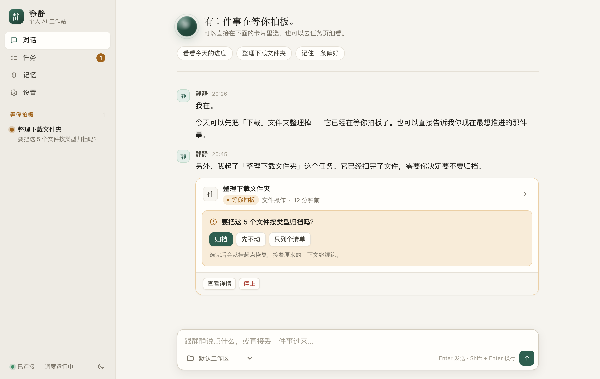
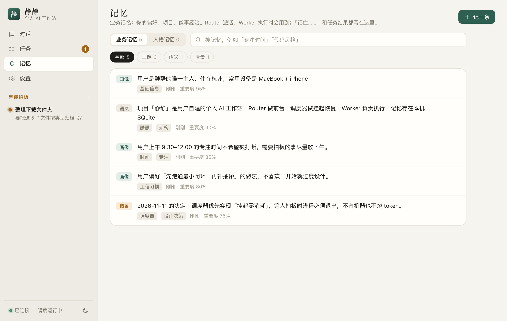
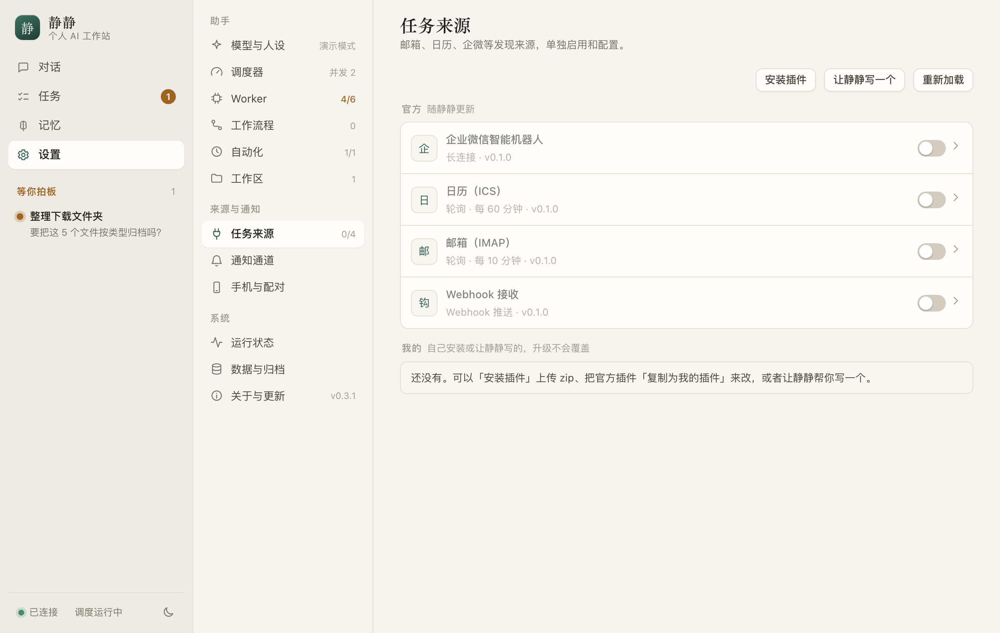
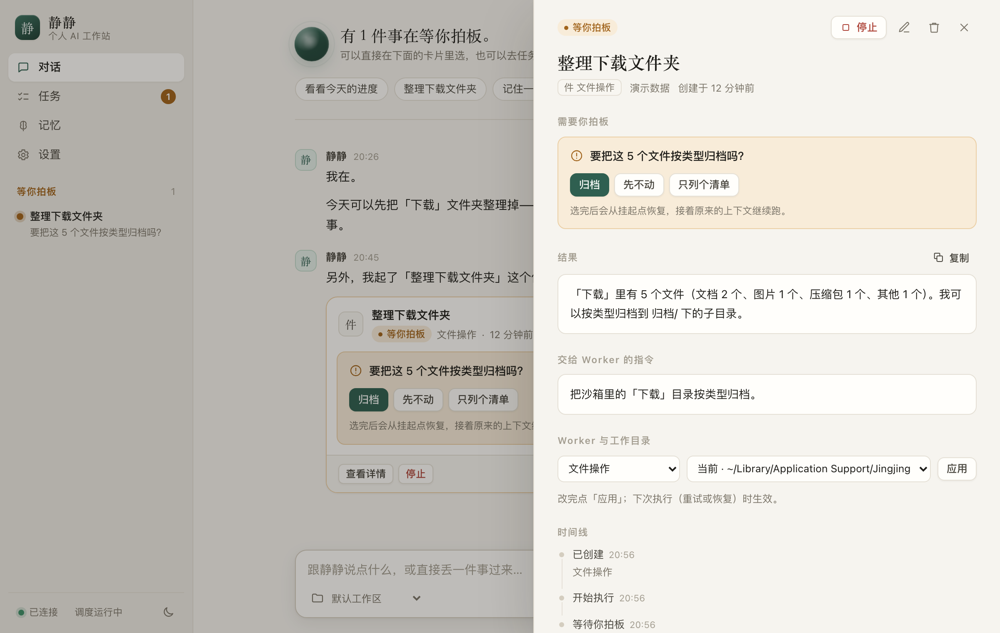
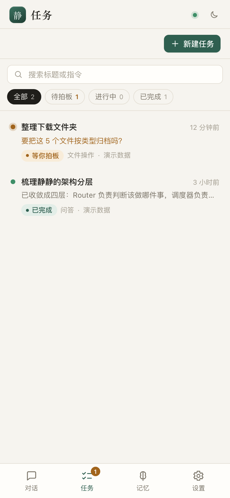

# 静静

> 一个住在你自己电脑里的个人 AI 工作站。  
> Router 负责判断，调度器负责把事办完，Worker 负责动手，记忆留在本机。

静静是把一段关于「个人 AI 管家」的讨论落成的可运行 MVP：**手机可以遥控、任务会停下来等你拍板、Agent 跑完就退出、记忆写进本地 SQLite**。邮箱、日历这类「任务从哪里被发现」的能力做成了插件，想加 RSS、GitHub 通知，写一个目录丢进去就行。

它现在能完整跑通这条闭环：

```
你说一句话
  → Router 判断这是聊天 / 记忆 / 任务 / 查进度
  → 任务交给调度器排队
  → 对应的 Worker 执行，实时进度回到对话
  → 需要你确认时，进程退出、状态落库、发通知
  → 你点一下，调度器从挂起点恢复，接着原来的上下文继续
  → 结果写回对话，并沉淀成一条情景记忆
```

---

## 界面

| 对话 | 等你拍板 |
| --- | --- |
|  |  |
|  |  |
|  |  |
|  |  |

<sub>深色模式见 [docs/screenshots/chat-dark.png](docs/screenshots/chat-dark.png)。</sub>

系统架构图：[docs/diagrams/architecture.png](docs/diagrams/architecture.png)（可编辑源：[architecture.html](docs/diagrams/architecture.html)）

---

## 快速开始

要求：Node.js **23.4+**（用到了内置的 `node:sqlite`，推荐 24），不需要安装任何依赖。

```bash
cd jingjing
npm start
```

打开 <http://127.0.0.1:7777>。

第一次打开需要配对码，它保存在 `data/access-key`：

```bash
cat data/access-key
```

也可以直接打开 `http://127.0.0.1:7777/pair?key=<配对码>` 自动登录。配对码同时用于手机访问和 API。

首次启动会自动生成演示数据：5 条记忆、2 个任务，其中一个正在等你拍板（整理沙箱里的「下载」文件夹）。直接点「归档」就能看到**挂起 → 恢复 → 完成**的完整过程。

> 演示模式不需要任何 API Key，Router 的意图识别和 Worker 输出都由本地逻辑模拟，但任务、审批、记忆、事件日志都是真实写入 SQLite 的。

清空演示数据并重新开始：

```bash
# 先停掉服务
npm run reset
npm start
```

跑测试（日历解析、IMAP 协议、MIME 正文、插件规范）：

```bash
npm test
npm run plugin:check
```

---

## 它做了什么

### 1. Router：只判断，不干活

`src/router.js` 接收你从网页 / Telegram 发来的每一条消息，判断它属于：

| 意图 | 行为 |
| --- | --- |
| `chat` | 带上记忆和任务板上下文回答，不创建任务 |
| `remember` | 抽取偏好/事实，写进画像或语义记忆 |
| `task` | 选一个 Worker，交给调度器，并在对话里生成任务卡 |
| `status` | 汇总进行中 / 等你拍板 / 最近完成 |
| `recall` | 检索记忆库 |

演示模式用规则分类；接入 DeepSeek / Ollama 后会改为让模型输出 JSON 意图。Router **不启动任何 Agent 进程**，它只负责“该不该做、交给谁”。

### 2. 调度器：工头，负责“挂起零消耗”

`src/scheduler.js` 是整套东西的核心：

- **队列与并发**：按优先级取任务，默认同时跑 2 个。
- **挂起零消耗**：Worker 需要你拍板时返回 `needs_approval`，调度器把审批写进 `approvals` 表，任务状态变成 `waiting_approval`，**Worker 进程此时已经退出**。不占 CPU、不烧 token。
- **恢复执行**：你点选项后，审批结果写进任务的 `resume_payload`，任务重新入队，Worker 带着“你选了什么”重新启动，从原来的上下文继续。
- **事件溯源**：每一次创建、开始、等待、拍板、重试、完成都追加到 `task_events`，任务详情里就是一条可回放的时间线。
- **超时、重试与熔断**：每个 Worker 自带运行限制（超时、最多同时运行几个、失败重试几次），可在设置里按主机覆盖。问答/文件生成失败会重试 1 次，编码类 Agent 默认不重试，超时一律不重试；单个任务最多恢复 6 次（`maxHops`），防止 Agent 在“问—答—再问”里循环。
- **取消就是取消**：取消或超时后调度器立刻释放槽位，Worker 晚到的结果会被丢弃，不会把任务改回完成或重新排队。
- **生命周期在本地还原**：任务状态只能按固定路线变化（比如已取消的任务不能被改成已完成）；每次执行有一条运行记录（第几次、心跳、Worker 存的断点、结束原因），任务详情里能看到。服务重启时，被打断的任务按 Worker 声明的方式还原：带断点继续、直接重跑，或者问你要不要重跑；同一任务连续被打断 3 次就停下，避免崩溃循环。
- **进度由 Worker 回传**：Worker 可以在进程内上报进度，外部进程用 `POST /api/runs/<id>/report`（凭本次执行的令牌）回传进度和断点；不回传的显示「等待回传」和已运行时长。Claude Code 会实时显示它在读哪个文件、跑什么命令。
- **崩溃恢复**：服务重启时，把卡在 `running` 的任务放回队列，而不是假装它还在跑。

### 3. Worker：无状态、可替换、全部插件化

每个 Worker 都只做一件事：拿到任务，跑一轮，返回结果，退出。内置 Worker 和第三方 Worker 是同一种插件包（`plugin.json` + `index.js`），内置的放在 `workers/<id>/`，随在线升级一起更新；它们只通过 `execute(task, ctx)` 的 `ctx` 使用宿主能力。

| Worker | 能力 | 说明 |
| --- | --- | --- |
| `llm` | text | 问答、分析、总结、起草；只输出文本，演示模式本地生成 |
| `file` | write-file | 让模型生成一份文本文件，写入任务工作区 |
| `shell` | manage-files | 扫描工作区并按类型归档，动手前先请你确认 |
| `claude` | code / write-file / manage-files / text | 调用本机 `claude -p`，支持 `--resume` 续跑 |
| `codex` | 同上 | 调用本机 `codex exec`（需自行安装） |
| `dsh` | 同上 | 在 DeepSeek Harness 环境里以 `dsh headless` 运行 |
| `memory` | memory | 本地统计与归档 |

Router 不认具体的 Worker id，只按能力派活（`src/worker-routing.js`）：文本需要什么能力，就在可用的 Worker 里挑具备该能力、开销（`cost`）最低的一个；插件还可以声明 `keywords`，被点名时优先。所以装上一个新的 Worker 插件，不用改任何核心代码就能被自动派到活。

任何外部 Agent 都可以通过约定接入：需要人拍板时，在输出的最后单独写一行

```
[[APPROVAL]] {"question":"要覆盖这个文件吗？","options":["覆盖","换个名字"]}
```

调度器会识别它并进入挂起流程。

### 4. 记忆：三层，全部在本机

`src/memory.js` 使用 SQLite + FTS5（trigram，中文可搜）：

- `profile`：你的长期偏好、作息、习惯。
- `semantic`：事实、项目、常用信息。
- `episodic`：发生过的决定和任务结果。

对话时 Router 会注入相关记忆；任务完成后自动写回一条情景记忆；你可以在「记忆」页搜索、补充、删除。**没有任何一条记忆会离开这台机器**，除非你主动接入了云端模型或通知通道。

### 5. 来源插件：把「发现」做成可插拔的

邮箱、日历不是写死在 Router 里的。`plugins/` 下每个目录就是一个来源插件：

```
plugins/
├── email-imap/    只读 IMAP → 新未读邮件
└── calendar/      ICS 订阅 → 接下来 24 小时的日程
```

插件只做两件事：拉数据、整形为条目。判断「要不要动手、交给谁、写成什么任务」由核心 `src/discovery.js` 负责。所以：

- 想加 RSS / GitHub 通知 / 公司内部系统，只需要照着 [插件文档](docs/PLUGIN.md) 写一个目录；
- 不信任某个来源，关掉开关即可，不会影响调度器和记忆；
- 插件失败只会更新自己的状态，不会拖垮主循环。

### 6. 通道：网页 + 手机

- 网页本身就是移动端优先的 PWA，可以“添加到主屏幕”。
- 配好 Telegram Bot 后，审批卡片会发到手机，点按钮就能恢复主机上的任务；你也可以直接在 Telegram 里给静静发指令。
- 飞书 / 通用 Webhook 用于接收提醒（单向）。

---

## 安装主机 App（macOS）

双击 `dist/静静-<版本>.pkg` 安装，或解压 `dist/静静-<版本>.zip` 把 App 拖进「应用程序」。

打开后菜单栏出现「静静」，服务自动启动，第一次会自动打开静静的窗口并完成配对。菜单里还可以显示/复制配对码、打开手机安装二维码、切换「仅本机访问」、开机时启动、重启和看日志。

- **原生窗口**：对话、任务板、记忆、设置都在静静自己的窗口里（和手机 PWA 是同一套界面）。窗口开着时出现在 Dock 和 ⌘Tab 里，关掉后退回菜单栏、服务继续跑；**⌥⌘J** 随时唤出 / 收起。下载的归档、备份存到「下载」文件夹，外部链接用系统浏览器打开；想用浏览器也可以点菜单里的「在浏览器中打开」。
- **系统通知**：任务需要你拍板时弹 macOS 通知，选项不超过 3 个可以直接在通知上点选；任务完成 / 失败也会通知（窗口在前台时不弹）。Dock 图标和菜单栏上显示待拍板的数量。第一次需要发通知时才会请求通知权限。
- **服务跟着 App 走**：退出、被强制结束甚至崩溃时，后台服务都会一起停止，不会残留进程占着端口。
- **数据位置**：`~/Library/Application Support/Jingjing/`。
- **手机安装**：菜单栏「手机安装二维码…」，手机扫码 → 自动配对 → Chrome 里「安装应用」。iPhone 用 Safari「添加到主屏幕」。

App 没有经过 Apple 公证，第一次打开需要右键 →「打开」。完整步骤、Tailscale 和排错见 [docs/MOBILE.md](docs/MOBILE.md)。

开发时可以直接用仓库里的代码构建并运行 App（默认用仓库的 `data/` 和 7787 端口，不影响已安装的静静）：

```bash
bash packaging/macos/dev.sh
```

也可以用命令行常驻（和 App 二选一，不要同时跑）：

```bash
JINGJING_HOST=0.0.0.0 bash scripts/install-service.sh
```

---

## 在线升级

从 v0.3.0 起，设置 →「关于」里可以检查并安装新版本：

- **检查**：请求 GitHub 最新 Release（`gh` 不需要；匿名 API 1 次/小时，带 ETag 缓存，避免触发限流）。
- **校验**：只用 Release 里的 `latest.json` 清单，强制比对 `sha256`；设置 `JINGJING_UPDATE_PUBKEY`（Ed25519 公钥 PEM）后会额外验签，签名消息是 `版本号\nsha256`。
- **安装**：安装到数据目录 `~/Library/Application Support/Jingjing/updates/<版本>/`，不覆盖 App 包、不动数据库、不需要管理员权限。
- **生效**：装完在菜单栏点「重启服务」。启动时 `server.js` 发现数据目录里版本更高，就交给它运行；如果新版本启动后 15 秒内崩溃，会标记失效并在下次启动自动回退内置版本。
- **回滚**：关于页有「回退版本」，回到上一版或内置版本。

升级只覆盖代码层（`server.js`、`src/`、`public/`、`plugins/`）。Swift 菜单栏宿主和内置 Node 运行时的变更仍需重新安装 pkg/zip。

### 发布一个版本

版本号只写在 `package.json`，其余位置（健康检查、界面、`Info.plist`、安装包文件名）都从它读取。流程：

```bash
# 1. 改 package.json 的 version
# 2. 提交并打 tag，推送后由 GitHub Actions 自动打包并发布
git commit -am "chore: release v0.3.1"
git tag v0.3.1
git push origin main --tags
```

工作流 [.github/workflows/release.yml](.github/workflows/release.yml) 会先跑测试，再生成 `dist/jingjing-app-<版本>.zip` 和 `dist/latest.json`（含 sha256），作为 Release 附件发布。本地想验证发布产物：

```bash
npm test
bash scripts/package-update.sh   # 产物在 dist/
```

### 用镜像或本地模拟源调试

```bash
JINGJING_UPDATE_REPO=owner/repo \
JINGJING_UPDATE_API_BASE=https://api.github.com \
npm start
```

把 `JINGJING_UPDATE_API_BASE` 指向一个本地假 GitHub API（提供 `repos/:owner/:repo/releases/latest` 和清单/压缩包），就能完整演练检查、安装、重启和回滚。

---

## 管理控制台

浏览器里的「管理」页是桌面端的运维入口：

- **服务概览**：运行时长、队列、今日完成、tokens、记忆、插件、SSE 连接、数据库大小；
- **队列控制**：一键暂停/恢复调度，暂停后新任务只排队、不执行；
- **任务管理**：搜索/筛选，失败任务重试、编辑标题/指令/Worker/优先级、删除任务及其事件与审批；
- **助手人设**：一段注入 Router 和 Worker 系统提示词的文字，改完立即生效；
- **记忆维护**：记忆页支持编辑内容、层级和重要度；
- **日志**：最近 200 条服务日志，出错时不用去翻终端；
- **备份**：下载 SQLite 数据库（可直接替换恢复），或导出不含密钥的 JSON。


## 工作区：每个来源绑定一个落点

任务来源决定「发现什么」，工作区决定「在哪个目录里干活」。设置 → 工作区里可以维护多个目录，点「选择」会打开 macOS 原生文件夹选择器；每个来源插件卡片上都有「任务工作区」下拉框，可以单独绑定，也可以直接选「自定义文件夹」。任务详情里同样可以改工作目录并应用。

- 没绑定的来源跟随默认工作区；
- 新建任务时，`cwd` 使用来源绑定的工作区，任务详情里能看到并修改工作目录（运行中的任务只读）；
- 插件不能自己指定目录，工作区由静静统一管理；
- 工作区只决定起点，不限制 Worker 能访问哪些目录；文件权限由 macOS 账户和 Worker CLI 自己的配置决定；
- 删除一个仍被插件使用的工作区时，那些插件会自动回到默认工作区。


## Worker 插件

Worker 是执行器，不是任务来源。内置 Worker 包括：问答、文件操作、文件生成、Claude Code、Codex、DeepSeek Harness、记忆整理。

- 内置 Worker 可以删除，删除后点「恢复内置 Worker」找回；
- 也可以安装 `kind: "worker"` 的插件，接入自己主机上的 Agent/CLI；manifest 里用 `worker` 段声明能力、开销、关键词和运行限制，写法见 [docs/PLUGIN.md](docs/PLUGIN.md#worker-插件)，模板在 `plugins/.template-worker/`；
- 每个 Worker（包括内置的）都可以在设置里调整超时、最多同时运行几个、失败重试几次；插件还有独立配置和 `detect()`，可以按主机环境判断是否可用；
- Worker 插件以当前 macOS 用户权限运行，静静不控制它的工具权限。

DeepSeek Harness 已经是内置 Worker，任务里选「DeepSeek Harness」即可用 `dsh headless` 执行。


### Worker 分配规则

设置 → Worker → 「添加规则」，可以按正则、来源、事件类型和工作区把任务分配给指定 Worker。规则从上到下匹配，第一条命中的生效；手动明确指定 Worker 的任务不经过规则。

示例：

- 正则 `github|pull request` + 来源 `plugin:*` → Claude Code
- 正则 `桌面|Desktop` → 文件生成
- 正则 `发票|invoice` + 来源 `plugin:email-imap` → 文件生成

来源支持 `web`、`plugin:*`、`plugin:email-imap` 等；事件类型支持 `email.unread`、`issues.*`、`*`。同一来源同一事项在排队时会合并成一条任务；事件的 `hops` 超过 8 层不再继续派发。规则里的 Worker 不可用时会被跳过，继续走默认 Router 判断。

## 工作流程与习惯

工作流程描述「遇到什么请求 → 派给哪个 Worker、在哪个工作区 → 按什么步骤做」。每个流程是一个 Markdown 文件：

```markdown
---
name: 写周报
when: 周报, weekly        # 触发词：逗号分隔，每段都可以是正则
worker: file              # 可选：派给哪个 Worker
workspace: 默认工作区      # 可选：工作区名称或 id
---

1. 汇总本周完成的任务，按项目分组
2. 每个项目写一句结论和下周计划
3. 保存为 周报-日期.md
```

- **读取你写好的流程**：设置 → 工作流程 → 「读取的文件夹」里填上放流程文档的文件夹（最多读 3 层、300 个 `.md`）。头部可以不写：没有 `when` 时按标题模糊匹配（比如「部署流程.md」能认出「帮我部署一下」）。静静**只读不改**这些文件，停用只记在本机；改完文件几秒内自动生效。
- **派活**：消息命中生效的流程时，不再让模型猜意图和 Worker，直接按流程派活，步骤会附在交给 Worker 的指令末尾。优先级：流程指定的 Worker > Worker 分配规则 > 按能力挑选。明显是提问（以「？」「吗」结尾）、要记东西或问进度的消息不套流程。来源插件发现的事项同样会匹配流程。
- **学习习惯**：对话或手动发起的任务完成后，如果过程不是一问一答（用了非纯文本 Worker、中途拍过板、被你改过 Worker 或重试过），静静会把经过总结成一个**候选习惯**，写到 `<数据目录>/workflows/learned/`，并在对话里发一张卡片：「保存为习惯 / 先改一改 / 忽略」。确认后同类请求就按它执行；忽略的不会再提议。任何完成的任务也可以在详情里手动点「总结成工作流程」。接了云端模型时由模型提炼步骤和触发词，演示模式按事件时间线生成。
- 每个流程会统计用过几次、成功几次，显示在设置页里。
- **自动拍板（可选）**：习惯会记下当时每个问题怎么选的（`answers: 要把这 \d+ 个文件归档吗？ => 归档`）。在设置 → 工作流程里打开它的「自动拍板」后，按这个习惯执行的任务遇到同样的问题会直接替你选，对话里留一句说明；遇到没记过的问题、或选项对不上时照常停下等你。默认关闭。

## 旧数据归档

管理控制台 → 归档旧数据。已结束超过保留天数（默认 90 天）的任务，连同事件、审批、执行记录和同期的旧对话，会先打包成 `<数据目录>/archive/archive-<时间>.jsonl.gz`，读回校验无误后才从数据库删除；默认每天自动检查一次。记忆和来源去重记录不清理（后者删了会让旧邮件被重新派活）。归档可以下载、按任务 id 或标题搜索，也可以把单个任务恢复回数据库。

## 设置：每个模块一个二级页面

设置不再是所有面板平铺：首页只显示分组入口（助手 / 来源 / 访问 / 系统），点进去才是该模块的表单，顶部有返回和独立的「保存」。配对、安装、插件、规则这类页面不显示全局保存，各自用卡片里的操作按钮。


## 接入真实模型

打开「设置 → 模型与称呼」：

- **DeepSeek**：填 API Key（默认 `https://api.deepseek.com`，模型 `deepseek-chat`）。Key 存在本机 SQLite 里。
- **Ollama**：填本机地址（默认 `http://127.0.0.1:11434`）和模型名，例如 `qwen2.5:7b`。
- 保存后 Router 会改用模型做意图识别，`llm` Worker 也会走真实模型。

模型连不上时，对话会回退到本地演示回复，不会让你卡在错误里。

---

## 主动发现

现在有两条并行的发现路径。

### A. 来源插件（设置 → 任务来源插件）

随包提供 3 个，默认关闭：

| 插件 | 需要的配置 | 它会做什么 |
| --- | --- | --- |
| 邮箱（IMAP） | 服务器、账号、授权码 | 只读拉取新未读邮件，按 UID 游标增量处理，判断是否需要回复/跟进 |
| 日历（ICS） | 一个只读的 ICS 订阅地址 | 用 ETag 缓存订阅，发现接下来 N 小时的日程，生成「准备日程」任务 |
| Webhook 接收 | 无；启用后自动生成地址 | 接收外部服务 POST 的 JSON，转成条目并建任务 |

每个插件都可以单独启用、填配置、测试连接、立即扫描。来源分成几种类型，频率也按来源单独配置：

- **轮询**（邮箱、日历）：每个插件有自己的「获取频率」，不是全局值；
- **Webhook 推送**：外部事件触发，没有轮询；
- **长连接**（企业微信）：常驻连接、自动重连，没有轮询；
- **手动**：只在点「立即扫描」时运行。

同一类来源可以添加多份实例（多个邮箱、多个日历、多个 Webhook、多个企微机器人）；每份实例有独立的配置、频率、工作区和状态。插件详情里能看到最近处理、运行历史和连续失败后的自动退避。插件把条目交给核心后：

1. 按 `externalId` 去重，扫过的不会再建任务；
2. 批量交给模型判断「要不要行动」，模型不可用时退回关键词规则；
3. 需要行动的建任务并在对话里汇总，不需要的静默跳过；
4. 插件状态（上次运行、结果、错误）在设置页可见。

插件开发看 [docs/PLUGIN.md](docs/PLUGIN.md)。manifest 有 JSON Schema（`plugins/plugin.schema.json`），`plugins/.template/` 是模板；写完跑 `npm run plugin:check` 做规范检查，加载失败会直接显示在设置页。

**安装不需要重新打包**：所有插件都在数据目录（命令行版 `data/plugins/`，App 版 `~/Library/Application Support/Jingjing/plugins/`）。安装包自带插件会在首次启动时复制进去，之后不再区分内置和外部；所有插件都能删除，在设置 → 任务来源插件 →「安装插件」上传 zip 即可。

**入站 Webhook**：随包提供「Webhook 接收」插件，启用后卡片里会生成一个 `POST /api/hooks/<token>` 地址。外部服务把 JSON POST 过去，插件只负责转成通用条目，去重、判断、建任务仍由静静处理。

**企业微信智能机器人**：以插件 zip 提供（`dist/plugins/wecom-0.1.0.zip`），用 WebSocket 长连接接收单聊/群聊 `@机器人` 消息，不需要公网 IP。安装和配置见 [docs/WECOM.md](docs/WECOM.md)。

### B. 每日简报

每天 08:00 汇总昨天完成的任务、今天等待处理的事项和近期记忆，生成一份简报。外部来源请用上面的任务来源插件。

---

## 目录结构

```
jingjing/
├── server.js              HTTP + SSE + 静态资源
├── src/
│   ├── config.js          路径、默认设置、状态文案
│   ├── db.js              SQLite 连接、建表、设置读写
│   ├── events.js          SSE 事件总线
│   ├── memory.js          分层记忆与中文检索
│   ├── llm.js             意图识别 + 模型适配 + 演示回复
│   ├── workers.js         Worker 注册表、宿主 API（ctx）、运行限制
│   ├── worker-routing.js  按能力 / 开销 / 关键词挑 Worker
│   ├── workflows.js       工作流程：读取 .md、匹配、学习习惯、自动拍板
│   ├── lifecycle.js       任务状态规则、运行记录、断点、回传令牌
│   ├── worker-runtime.js  不依赖数据库的 Worker 工具函数（主线程和插件线程共用）
│   ├── worker-thread.js   第三方 Worker 插件的执行线程
│   ├── archive.js         旧数据打包、清理、搜索、恢复
│   ├── scheduler.js       队列、挂起恢复、事件日志、重试
│   ├── router.js          Router、规则、对话
│   ├── plugins.js         来源插件加载、配置、状态
│   ├── plugin-spec.js     manifest / config 规范校验
│   ├── discovery.js       去重、模型判断、建任务
│   ├── channels.js        Telegram / 飞书 / Webhook
│   ├── auth.js            配对码、会话 Cookie、限流
│   ├── version.js         版本号唯一来源与 semver 比较
│   ├── overlay.js         启动时切换到数据目录里的新版本
│   ├── update.js          Release 检查、下载校验、安装与回滚
│   └── seed.js            演示数据
├── workers/               内置 Worker（和 Worker 插件同一种格式）
│   ├── llm/ file/ shell/ memory/
│   └── claude/ codex/ dsh/
├── plugins/               任务来源插件
│   ├── plugin.schema.json manifest 的 JSON Schema
│   ├── .template/         新来源插件模板
│   ├── .template-worker/  新 Worker 插件模板
│   ├── email-imap/        IMAP 客户端 + MIME 解析
│   └── calendar/          ICS 解析 + 日程任务
├── packaging/macos/       Swift 菜单栏 App + 打包脚本
├── .github/workflows/     tag 触发：测试、打包升级包、发 Release
├── scripts/               常驻服务安装 / 卸载 / 重置 / 升级包打包
├── tests/                 日历、IMAP、MIME 测试
├── docs/                  架构图、插件、手机使用
│   └── diagrams/          架构图（PNG + HTML 源）
├── public/                移动端 Web / PWA
├── dist/                  构建出来的 pkg / zip（不入库）
├── data/                  SQLite、沙箱、日志（不入库）
```

更细的时序、状态机和数据表见 [docs/ARCHITECTURE.md](docs/ARCHITECTURE.md)。

---

## 设计取舍

- **不做“常驻 Agent”**：Agent 跑一轮就退出，连续性由调度器的事件日志负责。任何一个 Agent 崩了都不会拖垮系统。
- **审批不是弹窗，是一条状态**：审批存在于数据库里，所以服务重启、手机断网、你隔一天再点，都能恢复。
- **工作区只是起点，不是沙箱**：`shell`、Claude Code、Codex 都以你当前 macOS 账户运行；能访问哪些文件由系统权限和 CLI 自己的配置决定。给静静选目录前请自己确认权限边界。
- **本地优先**：任务、事件、记忆、设置都在 `data/jingjing.db`。没有账号，没有云端同步。
- **发现和执行分离**：插件只交数据，判断和建任务留在核心，所以来源可以随时增删而不影响调度器。
- **配对码是唯一入口**：主机和手机共用一个码；HTTP 是明文的，所以默认建议 Tailscale 或可信局域网。
- **Web 是主机界面**：主机 App 只做启动器和配对，不重复写一套 UI；手机是同一个 Web 的 PWA。
- **先跑通闭环，再长功能**：这一版刻意没有做多用户、向量数据库、邮件 OAuth、原生移动 App。

---

## 已知限制

- 演示模式的回复是本地模板，不代表模型能力。
- IMAP 插件用本地 mock 服务器验证了协议与正文解析，但真实邮箱（Gmail/QQ/163）需要你用自己的授权码试一次；它不读附件，也暂不支持 OAuth。
- 日历插件只展开常见的 `DAILY/WEEKLY/MONTHLY` 重复规则，复杂的 `BYDAY/BYMONTHDAY` 组合可能漏掉；不做写回。
- Telegram 的双向通道需要你自己建 Bot；飞书只做了 Webhook 单向提醒，按钮回调还没接。
- `claude` Worker 的权限参数是保守默认值，第一次用建议在一个测试仓库里跑。
- `codex` Worker 已实现但没有在真实环境验证。
- 来源插件在服务进程内运行，拥有当前用户权限；只安装你信得过的插件。
- PWA 在后台/锁屏时没有系统推送；后台通知需要配 Telegram，或后续接 Web Push / APNs。
- 主机 App 只支持 macOS，安装包没有 Apple 公证；Windows / Linux 还没有安装包。
- 在线升级只更新代码层，且默认只靠 HTTPS 与 sha256 保证完整性；要防篡改请配置 Ed25519 公钥验签。
- 热更新生效期间会多一个常驻的守护进程（负责转发信号与崩溃回退），内存约多占一个空载 Node 进程。
- 管理页没有做「恢复备份」按钮：数据库备份需要停服务后手动替换文件。
- 没有做原生 Android / iOS 包，手机端是 PWA（Android 是真正的桌面安装）。

---

## 下一步可以做什么

1. **PWA 后台推送**：Web Push（Tailscale HTTPS）或接 FCM，让锁屏也能收到审批。
2. **更多来源插件**：RSS、GitHub 通知、飞书群消息，照 [docs/PLUGIN.md](docs/PLUGIN.md) 各写一个目录。
3. **主机 App 跨平台**：Windows / Linux 安装包，以及开机自启开关。
4. **记忆的自动整理**：定期把零散的情景记忆压缩成画像，淘汰过时偏好。
5. **任务依赖图**：让 Router 能派生子任务，调度器按 DAG 执行。
6. **多主机**：把 Worker 注册表拆成局域网内的执行节点，调度器统一排队。

---

静静不追求“什么都能做”。它先做到一件事：**你说的事，它记得住、接得下、卡住时会停下来等你，而你不在电脑前也能把它推完。**
