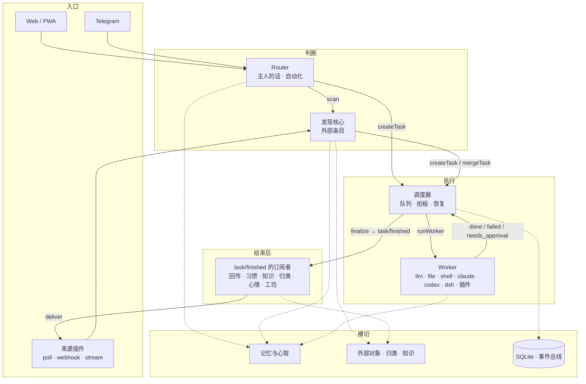

# 静静的架构

静静是一个本地优先的个人 AI 工作站：**发现**要做的事，**判断**交给谁，**调度**执行，需要你时**停下来问**，做完把结果**送回去**，一路上**记住**学到的东西。

这一页只讲整体框架：有哪几层、模块之间怎么连、主线怎么走。每个模块的细节、分步流程、接口在 [`architecture/`](architecture/) 下各自的文档里。


> 源文件 [diagrams/architecture.html](diagrams/architecture.html)（文件头注释里有重新渲染的命令）。改了架构时，这张图和下面的 Mermaid 图一起改。

---

## 分层



| 层 | 模块 | 一句话 | 文档 |
| --- | --- | --- | --- |
| 进程 | `server.js` `overlay` `update` `instance-lock` `archive` | 装配、启动顺序、定时器、HTTP 分发、退出、升级、归档 | [进程与运行时](architecture/runtime.md) |
| 判断 | `router.js` + `workflows` `worker-routing` `worker-rules` `llm` | 处理主人的话和自动化；判断意图、选 Worker、建任务 | [Router](architecture/router.md) |
| | `discovery.js` | 拉 / 接外部条目；去重、判断、建任务；同步外部状态 | [发现核心](architecture/discovery.md) |
| 执行 | `scheduler.js` `lifecycle.js` | 队列、并发、执行、拍板、重试、接着做、重启恢复 | [调度器与任务生命周期](architecture/scheduler.md) |
| | `workers.js` + `workers/*` | 无状态执行器，`execute(task, ctx)` 一个入口 | [Worker](architecture/workers.md) |
| 扩展 | `plugins.js` `plugin-*` | 插件的存放、校验、加载、热重载；让静静自己写插件 | [插件体系与插件工坊](architecture/plugins.md) |
| 通道 | `events.js` `channels.js` `relay.js` | SSE、Telegram、通知、消息类来源的双向回传 | [通道与回传](architecture/channels.md) |
| 横切 | `memory` `mind` `affect` `people` `persona` `conversation` | 两个域的长期记忆、心情、认识的人、反思与成长 | [记忆与心智](architecture/memory.md) |
| | `source-links` `task-classification` `knowledge` | 任务 ↔ 外部对象绑定、按外部树归类、分类知识 | [外部对象、归类与知识](architecture/external.md) |
| | `db.js` `events.js` | 表结构、事件总线 | [数据与事件](architecture/data.md) |
| | `auth.js` 等 | 配对、工作区、谁能决定什么、执行边界 | [配对、工作区与安全边界](architecture/security.md) |
| 界面 | `public/` | 无构建的原生 ES Module + PWA | [前端](architecture/frontend.md) |

---

## 主线

四条主线覆盖了静静做的所有事。每条只列骨架，步骤展开在对应的文档里。

### ① 主人说一句话

```
POST /api/chat · Telegram
  → router.handleMessage
      先查工作流程 → 模型判断意图（工具调用 / 两步 / 启发式）→ 校验模型的选择
      → 闲聊 / 记住 / 回想 / 进度 / 写插件：直接回复
      → 任务：选工作区 → 选 Worker（点名 > 流程 > 规则 > 模型 > 能力 > 兜底）→ scheduler.createTask
```

→ [Router · 处理一句话](architecture/router.md#处理一句话)

### ② 外面来了一件事

```
poll（每分钟检查到期）· webhook · stream（ctx.ingest）· 自动化 scan
  → discovery.ingestItems
      占位去重 → 批量判断要不要动手
      → 不用动手：跳过，或有人直接找她就按人格闲聊
      → 要动手：选流程和工作区 → 拼 prompt（记忆 + 分类知识）
               → 选 Worker（流程 > 规则 > 兜底，外部内容说了不算；有疑问先问主人）
               → 合并进已有任务，或 scheduler.createTask
      → 主对话汇总 · 渠道回执
```

→ [发现核心 · Ingest 流程](architecture/discovery.md#ingest-流程)

### ③ 任务被执行

```
scheduler.pump（原子占位，全局 + 每个 Worker 的并发）
  → execute：新建执行记录和一次性令牌 → runWorker(task, ctx)，与取消 / 超时赛跑
      → needs_approval：审批落库，调用栈结束（挂起零消耗）→ 主人拍板 → 带着选择重新入队
      → failed：按声明重试，或结束
      → done / failed / cancelled：finalize()
```

→ [调度器 · 执行](architecture/scheduler.md#执行) · [拍板](architecture/scheduler.md#拍板)

### ④ 任务结束之后

```
finalize() → task/finished
  → relay：发回原会话            → router：流程统计、提议成习惯
  → knowledge：学关系和结论      → classification：更新父卡
  → mind：任务成败推动心情       → plugin-forge：检查草稿、下一轮
```

→ [调度器 · 结束](architecture/scheduler.md#结束finalize-与扇出)

另外还有两条后台线：每分钟的**自动化与心智**（[Router · 自动化](architecture/router.md#自动化)、[记忆与心智](architecture/memory.md#每分钟mindtick)），以及服务**重启恢复与退出**（[调度器 · 重启恢复](architecture/scheduler.md#重启恢复)、[进程 · 正常退出](architecture/runtime.md#正常退出)）。

---

## 设计原则

| 原则 | 落在哪里 |
| --- | --- |
| **判断和执行分开**：Router 和发现核心只判断，执行只走调度器 | Router 不碰审批表、不启动 Worker；发现核心只调 `createTask` |
| **挂起零消耗**：等主人时什么都不跑 | `needs_approval` 落库后 Worker 调用栈结束，选完带着上下文重新入队 |
| **终态只有一个出口，下游只听一个事件** | `finalize()` → `task/finished`；加下游不用改调度器 |
| **外部内容不能决定交给谁** | 外部来源只认主人配的流程和规则；有疑问先问主人 |
| **能力归核心，映射归插件** | 插件只做 I/O、只说「这是谁、上级是谁、什么状态」；去重、判断、归类在核心 |
| **Worker 无状态、按声明调度** | 能力、开销、超时、并发、重试、恢复方式都写在 manifest |
| **库是唯一事实来源** | 内存里只有正在跑的执行；重启后以库为准；多步写入包事务；单实例锁 |
| **事件日志和物化状态并存** | `tasks` 查询快，`task_events` 审计全 |
| **本地优先** | 单进程、单文件 SQLite、零 npm 依赖、默认只听 127.0.0.1 |

---

## 文档地图

**架构（模块）** — 本目录 [`architecture/`](architecture/)

| 文档 | 内容 |
| --- | --- |
| [runtime.md](architecture/runtime.md) | 启动顺序、后台定时器、HTTP 分发、退出、单实例、升级、归档、运维接口 |
| [router.md](architecture/router.md) | 处理一句话、派活、选 Worker 的裁决规则、自动化（含例子）、习惯学习、工作流程 |
| [discovery.md](architecture/discovery.md) | 三种入口、调度节奏、ingest 流程、建任务、外部状态同步、长连接 |
| [scheduler.md](architecture/scheduler.md) | 状态机、建任务、排队、执行、拍板、结束扇出、接着做、重启恢复 |
| [workers.md](architecture/workers.md) | 内置 Worker、manifest、宿主 ctx、返回值、隔离线程、回传、选 Worker |
| [plugins.md](architecture/plugins.md) | 存放位置、加载、来源插件协议、宿主限制、安装、插件工坊 |
| [channels.md](architecture/channels.md) | SSE、Telegram、通知、消息类来源的回传 |
| [memory.md](architecture/memory.md) | 两个域、分层、读写时机、遗忘与回想、心智 |
| [memory-graph.md](architecture/memory-graph.md) | 记忆联想的诊断、外部做法、目标结构与分阶段方案（M0–M3 已完成） |
| [external.md](architecture/external.md) | 绑定与状态同步；归类（插件协议、三态、切层、算归属、生命周期、界面）；知识（来源、注入、晋升） |
| [data.md](architecture/data.md) | 表、库外数据、事件总线 |
| [security.md](architecture/security.md) | 配对、网络、工作区、谁能决定什么、执行边界、凭据 |
| [frontend.md](architecture/frontend.md) | 前端模块、数据流、视觉 |

**使用与运维**

| 文档 | 内容 |
| --- | --- |
| [MOBILE.md](MOBILE.md) | 主机安装与手机 PWA |
| [RELEASING.md](RELEASING.md) | 发版与在线升级 |
| `plugins/README.md` · `plugins/AUTHORING.md` | 写插件 |
