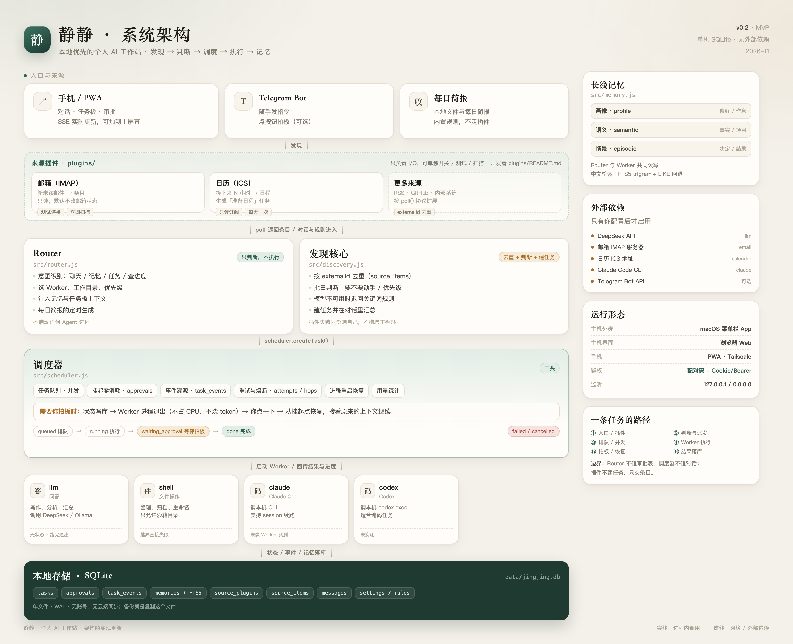
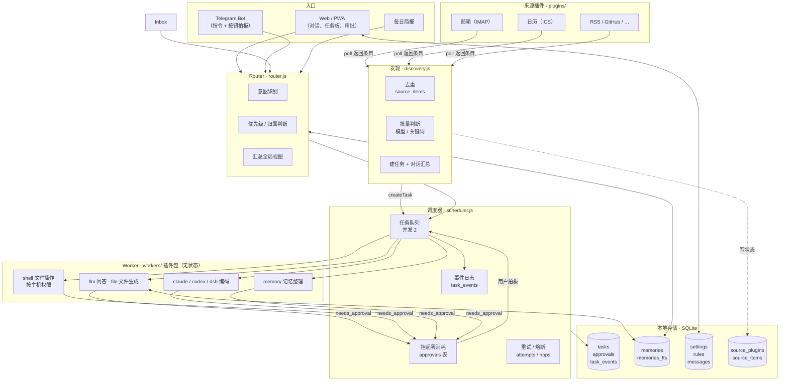

# 静静的架构

这份文档对应 `src/` 里的模块划分，目标是让“看一眼图就能找到代码在哪”。

## 总览



> 高清 PNG 在 [diagrams/architecture.png](diagrams/architecture.png)，可编辑的 HTML 源在 [diagrams/architecture.html](diagrams/architecture.html)。



## 一条任务的生命周期

```
                 createTask
                     │
                     ▼
                 ┌───────┐   pump()   ┌──────────┐
                 │queued │──────────▶│ running  │
                 └───────┘            └────┬─────┘
                     ▲                     │
                     │ approve(choice)     │ Worker 返回
                     │                     ▼
              ┌──────┴────────┐      ┌─────────────┐
              │waiting_approval│◀─────│needs_approval│
              └───────────────┘      └─────────────┘
                     │
                     │ Worker 返回 done / failed / cancelled
                     ▼
          ┌────────┬────────┬──────────┐
          │  done  │ failed │ cancelled│
          └────────┴────────┴──────────┘
```

关键点：

1. **进程退出发生在 `needs_approval` 分支**。`approvals` 落库后，Worker 的调用栈已经结束。
2. `approve()` 只做三件事：更新审批、把选择写进 `tasks.resume_payload`、把任务改回 `queued`。
3. 恢复时 Worker 拿到的是新的调用，但 `resume_payload` 里带着“上次问了什么、你选了什么、Claude 的 session_id”。
4. `hops` 超过 `maxHops` 时任务直接失败，避免无限追问。

## 数据库

| 表 | 用途 |
| --- | --- |
| `tasks` | 任务的物化状态（status、result、progress、tokens、hops…） |
| `task_events` | 只追加的事件日志，任务详情的时间线 |
| `approvals` | 待决问题、选项、选择结果 |
| `memories` | 分层记忆；`memories_fts` 是 trigram 全文索引 |
| `messages` | 对话历史（含 task_id 引用） |
| `settings` | 单行 JSON 配置（合并默认值） |
| `rules` | 内置发现规则（interval / daily） |
| `source_plugins` | 插件的启用状态、配置、上次运行结果 |
| `source_items` | 插件交回的条目，按 `(source, external_id)` 去重；保存标题、摘要、链接、发生时间 |

事件类型：

```
task/created → task/started → task/progress* → task/waiting_approval
   → approval/resolved → task/started → task/done
```

失败路径：`task/retry`（attempt < 2）或 `task/failed`；人工停止：`task/cancelled`；重启恢复：`task/recovered`。

任务走到终态（done / failed / cancelled）只有一个出口 `finalize()`：写状态和事件（同一个事务），然后推送、发 `task/finished`、通知、更新统计。不管是 Worker 返回、超时、执行异常、用户取消、拍板次数超限还是重启后放弃，下游（流程效果统计、自动发回原会话、插件工坊）都只听 `task/finished`。删除任务发 `task/deleted`。

服务退出（SIGTERM / SIGINT / 桌面 App 退出）时，调度器中止所有执行，给子进程整组发 SIGTERM，1.5 秒后 SIGKILL，运行记录记为 `interrupted`；任务保持 `running`，下次启动由 `recover()` 按 Worker 声明的恢复方式接着做。正常退出打断的不算进「连续被重启打断」的次数，只有崩溃、被强制结束才算。

## 来源插件与发现

插件统一放在数据目录的 `plugins/`（命令行版 `data/plugins/`，App 版 `~/Library/Application Support/Jingjing/plugins/`）。安装包里的 `plugins/` 是首次启动的种子，复制后不再区分来源；所有插件都可以删除，不需要重新打包。

两层职责分得很开：

- **插件**（`plugins/*/index.js`）只做 I/O：登录邮箱、拉 ICS、调第三方 API，或者接收 webhook，然后返回 `items[]`。
- **发现核心**（`src/discovery.js`）不关心来源是什么：去重、判断、建任务、发对话消息、更新插件状态。

```js
// 插件只需要导出这两个函数
export async function poll(config, ctx) {
  return {
    items: [{
      externalId: '稳定且唯一',   // 去重键
      kind: 'email',             // email | agenda | note
      title: '...',
      content: '...',
      meta: {},
      occurredAt: '...'
    }]
  };
}
export async function test(config) { return { ok: true, detail: '...' }; }
```

入站 Webhook 走另一条入口：`POST /api/hooks/<token>` → 插件的 `webhook(payload)`（15 秒上限）→ 立即回应发送方 → 后台 `ingestItems()`，后面的去重、判断、建任务与轮询完全共用。不等模型判断再回应，免得发送方超时重发。

长连接来源（企业微信智能机器人）由插件的 `start(config, ctx)` 主动连接，收到消息后调用 `ctx.ingest(items)`；启用/停用/改配置时核心负责启动和停止这条连接。插件用 `ctx.status(detail)` 报告连接状态，连接彻底断了用 `ctx.fail(reason)` 交回核心，核心按退避（30 秒起翻倍，最长 30 分钟）自动重启；`start()` 抛错或 30 秒没返回也一样。服务启动时长连接并行启动、不阻塞监听端口。

发现流程：

```
插件 poll（90s 超时，宿主强制）
  → 截断到 10 条 → 占位 source_items(status=pending)，占不到的算已见
  → 批量问模型：要行动吗？标题？执行提示？属于哪个工作流程？
  → 读取该来源绑定的工作区
  → createTask(worker=流程指定 > 分配规则 > 最便宜的文本 Worker, cwd=工作区路径, origin=plugin:<id>)
  → source_items 记 task / merged / skipped（出错就放掉占位，下次重来）
  → 主对话一条汇总 + 插件状态更新
```

先占位再判断：判断要等模型，同一条在这期间再进来（发送方重发、长连接重放）也不会建出两个任务。进程在判断途中退出留下的 pending 占位，下次启动时清掉。

**外部内容不能决定交给谁**：条目是外人写的（邮件、群消息、Webhook），所以派 Worker 只认主人的配置——工作流程指定的 Worker、分配规则，都没命中就交给最便宜的文本 Worker。消息里点名的 Worker、模型挑的 Worker、按文字推断出的能力都不算；模型只能在主人配好的工作流程里判断属于哪个。只有主人在对话里（Web、配对的 Telegram）才能点名 Worker。

外部消息点名了本机可用的 Worker、或含有默认 Worker 做不了的强能力信号（代码、仓库、生成文件），而流程和规则都没命中时，不直接降级成文字回复：`createTask({ hold })` 建好任务就停在一条 `kind = 'routing'` 的审批上（`approvals.meta.choices` 记着每个选项交给谁、要不要顺手建规则）。主人选了才改派并入队；选「以后这类都交给它」由 `ensureWorkerRule()` 建一条限定这个来源的分配规则（同样的规则已存在就复用）。这类审批选的是 Worker，不是给 Worker 的答复，所以不传给 Worker、不算拍板次数，也不会被记进习惯。

模型不可用时退回关键词规则；插件抛错或超时只影响它自己，不会中断其他来源或调度器。

## 并发与一致性

- `pump()` 用 `UPDATE ... WHERE status = 'queued'` 做原子占位，避免同一任务被调度两次。
- 所有状态变化都走 `setStatus()`，并同步写一条事件；拍板、挂起、重试、删除这类多步写入包在 `transaction()` 里，崩溃时不会留下「审批已处理、任务还在等」的半截状态。
- 内存里只有 `running` 这个运行时 Map；重启后以数据库为准。
- 同一个数据目录只允许一个服务进程（`instance-lock.js`，SQLite 独占文件锁，进程退出时由系统释放）：否则第二个进程的 `recover()` 会把第一个进程正在跑的任务当成被打断、再执行一遍。启动顺序是先拿锁、再监听端口、最后才 `recover()` 和开始调度。
- 插件重新加载时，入口带上整个插件目录的版本号，并通过模块钩子传给入口相对引用的子文件（`plugin-loader.js`），多文件插件重装后不用重启。
- SSE 只负责推送变化，前端每次以 API 返回的任务对象覆盖本地副本，不做增量推断。

## 记忆的读写时机

| 时机 | 层 | 内容 |
| --- | --- | --- |
| 用户说「记住…」/ 明确的偏好 | profile / semantic | 抽取后写入，去重 |
| Router 回答前 | — | 按当前问题检索，拼进 system prompt |
| 任务完成 | episodic | `任务「…」的结果：…`，截断 400 字 |
| 手动添加 / 删除 | 任意 | 记忆页 |

检索优先用 FTS5 trigram；查询少于 3 个字符时退回 `LIKE`，保证中文两字词（如「周报」）也能命中。

## Router 的边界

Router **不碰** `approvals` 表，也**不启动** Worker。插件发现走的是 `discovery.js`，同样只通过 `scheduler.createTask` 进入执行层。Router 只做：

- 意图判断（规则或模型 JSON）
- 先查工作流程（`workflows.js`）：命中生效的流程就跳过模型判断，按流程的 Worker / 工作区派活，并把步骤附进指令
- 决定 Worker（流程指定 > 分配规则 > 按能力 / 开销 / 关键词，见 `worker-routing.js`）、标题、工作目录
- 任务结束时（调度器发出 `task/finished`）统计流程效果；值得记住的任务总结成候选习惯，等用户在对话里确认
- 把任务交给 `scheduler.createTask`
- 每日简报到点建任务，往对话里留一条说明

调度器**不碰**会话消息和长期记忆（除了完成时写回一条情景记忆）。这条边界让两边都可以单独测试。

## 配对与访问

- 首次启动会在 `data/access-key` 生成配对码（20 位，分组显示）。
- 浏览器通过 `POST /api/auth/login` 换取 HttpOnly Cookie；脚本和外部客户端用 `Authorization: Bearer <配对码>`。
- `/pair?key=…` 是主机 App 打开浏览器时用的自动登录入口：校验后种 Cookie 并 302 回首页。
- 除 `/api/health`、`/api/auth/status`、`/api/auth/login`、`/api/auth/logout` 外，所有 `/api/*`（包括 SSE）都需要配对。
- 登录按 IP 限流（5 分钟 10 次）；重新生成配对码会立即让所有设备失效。
- 静态资源（登录页、PWA 外壳）公开，但里面的数据请求全部需要配对。

### 工作区

`settings.workspaces` 保存命名目录，`defaultWorkspaceId` 是兜底。设置页通过 macOS 原生文件夹选择器添加任意目录，可配置多条。`source_plugins.workspace_id` 记录每个来源的绑定；`discovery.ingestItems()` 建任务时解析出工作区并写入 `tasks.cwd`。删除工作区时，失效的插件绑定会被清空，回落到默认工作区。

工作区只决定任务的 `cwd`，不是权限边界：Worker 以当前 macOS 账户运行，文件权限和工具权限由系统、Claude Code/Codex 自身配置决定，静静不注入工具白名单或权限模式。

## 管理控制台

桌面端的「管理」页只走受保护的 HTTP API，不直接碰数据库：

- `GET /api/admin/overview`：运行时长、队列、数据库大小、插件/通道状态；
- `POST /api/admin/queue`：暂停/恢复调度（写 `settings.queuePaused`，`pump()` 会检查）；
- `PATCH /api/tasks/:id`、`POST /api/tasks/:id/retry`、`DELETE /api/tasks/:id`：任务编辑、重试、删除；
- `PATCH /api/memories/:id`：记忆内容/层级/重要度；
- `GET /api/admin/logs`：内存日志环（最近 600 条）；
- `GET /api/admin/backup`：WAL checkpoint 后下载 SQLite 文件；
- `GET /api/admin/export`：导出任务、记忆、规则和打码后的配置。

任务编辑/删除只允许非运行态；重试会清空 attempts/hops 并把审批作废，避免旧审批把任务拉回错误状态。

## 通道

- Web / PWA：HTTP + SSE（`/api/stream`），断线由浏览器自动重连。同一个浏览器（IP + UA）最多保留 3 条实时连接，不同设备互不挤占。
- Telegram：`getUpdates` 长轮询；审批按钮的 `callback_data` 是 `approve:<approvalId>:<choice>`。只认设置里配置的 Chat ID，别的会话发来的消息和按钮一律丢弃（日志里会记下对方的 Chat ID，方便第一次配置）。
- 飞书 / 通用 Webhook：单向 POST，失败会通过 SSE 推一条提醒到界面。

## 安全边界

- `shell` / `file` Worker 只在任务工作区里移动或写入文件，目标路径越出工作区（`isInside` 校验）直接失败；工作区本身可以是任意目录。
- 服务默认只监听 `127.0.0.1`；开放到局域网需要显式设 `JINGJING_HOST=0.0.0.0`。
- 页面渲染对模型输出做 HTML 转义，Markdown 只支持白名单语法。
- 插件拿到的设置里没有模型 Key 和通知通道凭据；只有随代码发布的内置 Worker 能通过 `ctx.secrets` 拿到 Key。
- 第三方 Worker 插件的 `execute` 在独立线程里运行，取消 / 超时后会被强制结束；但它仍是同一个 Node 进程、同一个系统账户，能读写本机文件，不是安全沙箱。来源插件仍在主线程运行（各入口有宿主强制的时间上限，但同步死循环仍会卡住整个服务）。只安装可信插件，manifest 里的 `capabilities` 只是声明，不做强制。
- 外部来源（邮件、企微、Webhook）的内容不能决定交给哪个 Worker，见「来源插件与发现」；Telegram 只认配置的 Chat ID。能让有工具能力的 Worker 处理外部内容的，只有主人自己配的工作流程和分配规则。
- 回传接口 `/api/runs/<id>/report` 不需要配对码，只认本次执行的一次性令牌（库里存哈希，执行结束即失效）。
- API Key 存在本机 SQLite；接口返回时打码，保存时保留原值。
- Claude Code 以 `claude -p` 运行，工具权限完全交给 Claude Code 自身的用户配置，静静不追加权限参数，也不使用 `--dangerously-skip-permissions`。

## 为什么这样切模块

- `router.js` / `scheduler.js` / `workers.js` 三个文件分别对应架构图上的三层，读代码时不需要在层之间跳。
- 插件和发现核心分离：新增来源不用改 Router、调度器或 Worker，只加一个目录。
- Worker 只有 `execute(task, ctx)` 一个入口，内置的和第三方的是同一种插件包；新增一种 Agent 只加一个目录，不用改 Router 或调度器——Router 按 manifest 声明的能力派活，调度器按声明的超时 / 并发 / 重试执行。
- 记忆是横切能力：Router 和 Worker 都通过 `memory.js` 读写，而不是各自持有上下文。
- 事件日志和物化状态并存：查询快，审计全。代价是写任务时多一条 insert，个人场景完全可接受。
